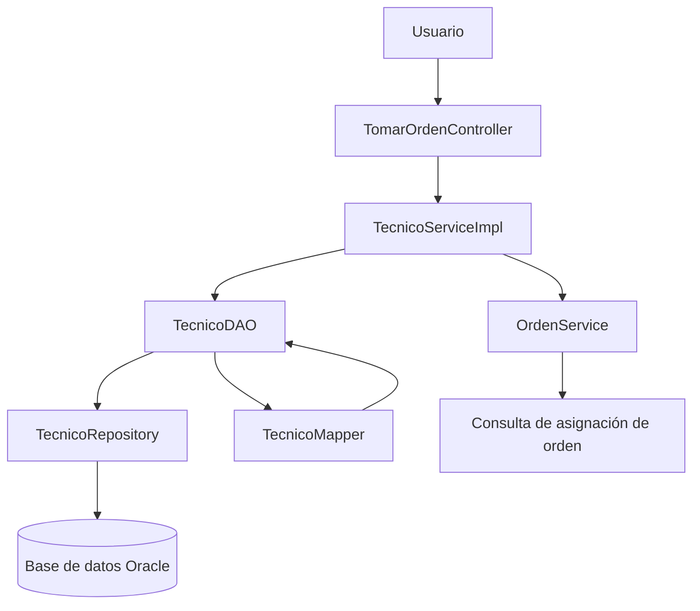

# Diagnóstico de refactorización – Reparatodo

## 1. Contexto

### 1.1 Equipo

El proyecto Reparatodo es desarrollado por un equipo de trabajo académico como parte de la asignatura de Ingeniería de Software II.

**Integrantes:** [Nombres de los integrantes del equipo].

### 1.2 Repositorio

- **Nombre del proyecto:** Reparatodo.
- **Repositorio:** .
- **Rama de trabajo:** main.
- **Lenguaje de programación:** Java.
- **Framework:** Spring Boot.
- **Persistencia:** Spring Data JPA y Hibernate.
- **Base de datos:** Oracle Database.
- **Interfaz de usuario:** Thymeleaf.

### 1.3 Funcionalidad auditada

La funcionalidad seleccionada para la auditoría es **Tomar orden**, cuyo propósito es permitir que un técnico registrado asuma una orden de reparación disponible en el sistema.

Para realizar esta operación, el sistema recibe la identificación del técnico y de la orden. Antes de actualizar la información, se realizan validaciones para comprobar que el técnico exista, que no tenga otra orden asignada y que la orden solicitada no esté asignada a otro técnico.

Cuando las validaciones se cumplen, el sistema actualiza la información correspondiente y cambia el estado del técnico a `OCUPADO`.

Los principales componentes involucrados son:

- `TomarOrdenController`: recibe las solicitudes y coordina la operación.
- `TecnicoServiceImpl`: ejecuta las reglas de negocio relacionadas con la asignación.
- `TecnicoDAO`: gestiona las operaciones de acceso y actualización de datos.
- `TecnicoRepository`: permite consultar y persistir la información mediante Spring Data JPA.
- `TecnicoMapper`: transforma los objetos entre DTO y entidades.

### 1.4 Requisitos relacionados

| Código | Requisito | Relación con la funcionalidad |
|---|---|---|
| BR-01 | El técnico tomará una orden del sistema. | Permite asignar una orden de reparación a un técnico registrado. |
| BR-02 | Reducir los atrasos de las reparaciones. | Busca facilitar la asignación de órdenes y evitar demoras en su atención. |
| BR-03 | Agilizar las reparaciones. | Facilita que los técnicos puedan asumir órdenes disponibles e iniciar su atención. |

La auditoría busca identificar posibles problemas en la validación de datos, las reglas de asignación y el manejo de operaciones simultáneas, con el propósito de establecer mejoras que contribuyan a la calidad, mantenibilidad y confiabilidad del sistema.

## 2. Arquitectura real

### 2.1 Componentes involucrados

La funcionalidad **Tomar orden** utiliza una arquitectura por capas, en la que cada componente tiene una responsabilidad específica dentro del proceso de asignación de órdenes.

| Componente | Capa | Responsabilidad |
|---|---|---|
| `TomarOrdenController` | Presentación | Recibe la solicitud del usuario, obtiene los datos del técnico y de la orden, y ejecuta el servicio correspondiente. |
| `TecnicoServiceImpl` | Negocio | Contiene las reglas de negocio, verifica las condiciones para asignar una orden y coordina la actualización del técnico. |
| `TecnicoDAO` | Acceso a datos | Consulta y actualiza la información del técnico mediante el repositorio. |
| `TecnicoRepository` | Persistencia | Proporciona las operaciones de consulta y almacenamiento utilizando Spring Data JPA. |
| `TecnicoMapper` | Transformación de datos | Convierte los datos entre los DTO y las entidades utilizadas por la aplicación. |
| `OrdenService` | Negocio | Verifica si la orden solicitada ya tiene un técnico asignado. |

### 2.2 Dependencias entre componentes

La comunicación entre los componentes sigue una estructura en la que el controlador delega las operaciones al servicio, el servicio utiliza los componentes de acceso a datos y consulta otros servicios cuando necesita validar reglas de negocio.

Las principales dependencias son:

- `TomarOrdenController` depende de `TecnicoService` para ejecutar la asignación del técnico.
- `TecnicoServiceImpl` depende de `TecnicoDAO` para consultar y actualizar los técnicos.
- `TecnicoServiceImpl` depende de `OrdenService` para comprobar si una orden ya tiene un técnico asignado.
- `TecnicoDAO` depende de `TecnicoRepository` para acceder a la base de datos.
- `TecnicoDAO` utiliza `TecnicoMapper` para realizar las conversiones entre objetos.

### 2.3 Flujo de la funcionalidad

El proceso de tomar una orden se desarrolla de la siguiente manera:

1. El usuario selecciona una orden disponible e introduce la identificación del técnico.
2. `TomarOrdenController` recibe el identificador de la orden y la cédula del técnico.
3. El controlador construye un objeto `ActualizarTecnico` con el estado `OCUPADO` y el identificador de la orden.
4. El controlador llama al método `actualizarTecnico()` de `TecnicoService`.
5. `TecnicoServiceImpl` verifica que el técnico exista.
6. Se comprueba que el técnico no tenga otra orden asignada.
7. Se consulta `OrdenService` para verificar que la orden no esté asignada a otro técnico.
8. Se validan los datos necesarios para realizar la actualización.
9. `TecnicoDAO` recupera el técnico, utiliza `TecnicoMapper` para actualizar los datos y guarda los cambios mediante `TecnicoRepository`.
10. El controlador recibe el resultado y comunica al usuario si la operación fue exitosa o si ocurrió algún error.

### 2.4 Diagrama de componentes

El siguiente diagrama representa las dependencias principales de la funcionalidad:

### 2.5 Observaciones arquitectónicas

La funcionalidad presenta una separación básica de responsabilidades mediante capas de presentación, negocio y persistencia. Esta organización facilita la identificación de los componentes responsables de cada operación.

Sin embargo, durante la auditoría se identificaron aspectos que requieren revisión:

- La validación de los datos se realiza después de algunas consultas en el servicio.
- La verificación de que un técnico y una orden estén disponibles podría requerir protección adicional ante solicitudes simultáneas.
- No se observa en el código revisado una validación completa de las transiciones permitidas entre estados del técnico y de la orden.

Estos aspectos se analizarán con mayor detalle en los hallazgos de auditoría y las propuestas de refactorización.

