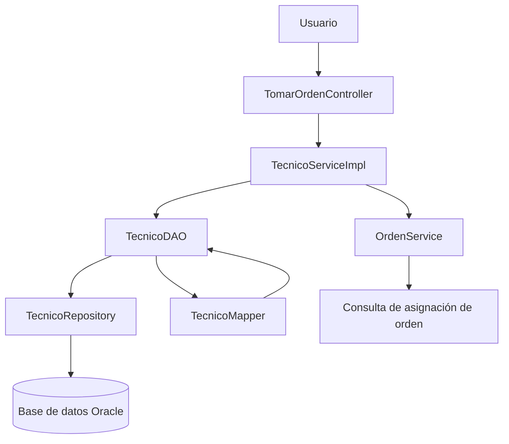

# Diagnóstico de refactorización – Reparatodo

## 1. Contexto

### 1.1 Equipo

El proyecto Reparatodo es desarrollado por un equipo de trabajo académico como parte de la asignatura de Ingeniería de Software II.

**Integrantes:** [Nombres de los integrantes del equipo].

### 1.2 Repositorio

- **Nombre del proyecto:** Reparatodo.
- **Repositorio:** .
- **Rama de trabajo:** main.
- **Lenguaje de programación:** Java.
- **Framework:** Spring Boot.
- **Persistencia:** Spring Data JPA y Hibernate.
- **Base de datos:** Oracle Database.
- **Interfaz de usuario:** Thymeleaf.

### 1.3 Funcionalidad auditada

La funcionalidad seleccionada para la auditoría es **Tomar orden**, cuyo propósito es permitir que un técnico registrado asuma una orden de reparación disponible en el sistema.

Para realizar esta operación, el sistema recibe la identificación del técnico y de la orden. Antes de actualizar la información, se realizan validaciones para comprobar que el técnico exista, que no tenga otra orden asignada y que la orden solicitada no esté asignada a otro técnico.

Cuando las validaciones se cumplen, el sistema actualiza la información correspondiente y cambia el estado del técnico a `OCUPADO`.

Los principales componentes involucrados son:

- `TomarOrdenController`: recibe las solicitudes y coordina la operación.
- `TecnicoServiceImpl`: ejecuta las reglas de negocio relacionadas con la asignación.
- `TecnicoDAO`: gestiona las operaciones de acceso y actualización de datos.
- `TecnicoRepository`: permite consultar y persistir la información mediante Spring Data JPA.
- `TecnicoMapper`: transforma los objetos entre DTO y entidades.

### 1.4 Requisitos relacionados

| Código | Requisito | Relación con la funcionalidad |
|---|---|---|
| BR-01 | El técnico tomará una orden del sistema. | Permite asignar una orden de reparación a un técnico registrado. |
| BR-02 | Reducir los atrasos de las reparaciones. | Busca facilitar la asignación de órdenes y evitar demoras en su atención. |
| BR-03 | Agilizar las reparaciones. | Facilita que los técnicos puedan asumir órdenes disponibles e iniciar su atención. |

La auditoría busca identificar posibles problemas en la validación de datos, las reglas de asignación y el manejo de operaciones simultáneas, con el propósito de establecer mejoras que contribuyan a la calidad, mantenibilidad y confiabilidad del sistema.

## 2. Arquitectura real

### 2.1 Componentes involucrados

La funcionalidad **Tomar orden** utiliza una arquitectura por capas, en la que cada componente tiene una responsabilidad específica dentro del proceso de asignación de órdenes.

| Componente | Capa | Responsabilidad |
|---|---|---|
| `TomarOrdenController` | Presentación | Recibe la solicitud del usuario, obtiene los datos del técnico y de la orden, y ejecuta el servicio correspondiente. |
| `TecnicoServiceImpl` | Negocio | Contiene las reglas de negocio, verifica las condiciones para asignar una orden y coordina la actualización del técnico. |
| `TecnicoDAO` | Acceso a datos | Consulta y actualiza la información del técnico mediante el repositorio. |
| `TecnicoRepository` | Persistencia | Proporciona las operaciones de consulta y almacenamiento utilizando Spring Data JPA. |
| `TecnicoMapper` | Transformación de datos | Convierte los datos entre los DTO y las entidades utilizadas por la aplicación. |
| `OrdenService` | Negocio | Verifica si la orden solicitada ya tiene un técnico asignado. |

### 2.2 Dependencias entre componentes

La comunicación entre los componentes sigue una estructura en la que el controlador delega las operaciones al servicio, el servicio utiliza los componentes de acceso a datos y consulta otros servicios cuando necesita validar reglas de negocio.

Las principales dependencias son:

- `TomarOrdenController` depende de `TecnicoService` para ejecutar la asignación del técnico.
- `TecnicoServiceImpl` depende de `TecnicoDAO` para consultar y actualizar los técnicos.
- `TecnicoServiceImpl` depende de `OrdenService` para comprobar si una orden ya tiene un técnico asignado.
- `TecnicoDAO` depende de `TecnicoRepository` para acceder a la base de datos.
- `TecnicoDAO` utiliza `TecnicoMapper` para realizar las conversiones entre objetos.

### 2.3 Flujo de la funcionalidad

El proceso de tomar una orden se desarrolla de la siguiente manera:

1. El usuario selecciona una orden disponible e introduce la identificación del técnico.
2. `TomarOrdenController` recibe el identificador de la orden y la cédula del técnico.
3. El controlador construye un objeto `ActualizarTecnico` con el estado `OCUPADO` y el identificador de la orden.
4. El controlador llama al método `actualizarTecnico()` de `TecnicoService`.
5. `TecnicoServiceImpl` verifica que el técnico exista.
6. Se comprueba que el técnico no tenga otra orden asignada.
7. Se consulta `OrdenService` para verificar que la orden no esté asignada a otro técnico.
8. Se validan los datos necesarios para realizar la actualización.
9. `TecnicoDAO` recupera el técnico, utiliza `TecnicoMapper` para actualizar los datos y guarda los cambios mediante `TecnicoRepository`.
10. El controlador recibe el resultado y comunica al usuario si la operación fue exitosa o si ocurrió algún error.

### 2.4 Diagrama de componentes

El siguiente diagrama representa las dependencias principales de la funcionalidad:



### 2.5 Observaciones arquitectónicas

La funcionalidad presenta una separación básica de responsabilidades mediante capas de presentación, negocio y persistencia. Esta organización facilita la identificación de los componentes responsables de cada operación.

Sin embargo, durante la auditoría se identificaron aspectos que requieren revisión:

- La validación de los datos se realiza después de algunas consultas en el servicio.
- La verificación de que un técnico y una orden estén disponibles podría requerir protección adicional ante solicitudes simultáneas.
- No se observa en el código revisado una validación completa de las transiciones permitidas entre estados del técnico y de la orden.

Estos aspectos se analizarán con mayor detalle en los hallazgos de auditoría y las propuestas de refactorización.**
## 3. Hallazgos de auditoría

Se identificaron tres hallazgos relacionados con la validación de datos, la asignación de órdenes y el control de los estados del técnico. Estos hallazgos se seleccionaron por su posible impacto en la confiabilidad y el correcto funcionamiento de la funcionalidad **Tomar orden**.

### 3.1 Hallazgo H-03: Validación de datos después de las consultas

- **ID:** H-03
- **Ruta:** `src/main/java/Reparatodo/Repa/Bussines/Service/Impl/TecnicoServiceImpl.java` (ajustar según la ubicación real del archivo).
- **Método:** `actualizarTecnico(Long id, ActualizarTecnico actualizarTecnico)`.
- **Líneas:** [Completar con las líneas exactas del método].
- **Evidencia:**

```java
if (!tecnicoDAO.findById(id).isPresent()) {
    throw new TecnicoNoEncontradoException(id);
}

if (tecnicoDAO.existsByOrdenEntity(id)) {
    throw new TecnicoOrdenAsignada(id);
}

if (ordenService.tecnicoAsignado(actualizarTecnico.getIdOrden())) {
    throw new OrdenConTecnicoAsignadoException(id);
}

validarDatos(actualizarTecnico);
```

- **Categoría:** Oportunidad de mejora / posible defecto funcional por validar los datos después de ejecutar consultas.
- **Justificación:** La validación de los datos de entrada se realiza después de consultar la existencia del técnico y las asignaciones. Es conveniente validar primero los datos necesarios para evitar ejecutar consultas con información inválida.
- **Consecuencia:** Se pueden realizar consultas innecesarias y generar errores o resultados poco claros cuando los datos recibidos no cumplen las condiciones esperadas. No se ha demostrado todavía un fallo funcional reproducible.

### 3.2 Hallazgo H-09: Riesgo de asignación simultánea de órdenes

- **ID:** H-09
- **Ruta:** `src/main/java/Reparatodo/Repa/Bussines/Service/Impl/TecnicoServiceImpl.java` (ajustar según la ubicación real del archivo).
- **Método:** `actualizarTecnico(Long id, ActualizarTecnico actualizarTecnico)`.
- **Líneas:** [Completar con las líneas de las comprobaciones de asignación y actualización].
- **Evidencia:**

```java
if (tecnicoDAO.existsByOrdenEntity(id)) {
    throw new TecnicoOrdenAsignada(id);
}

if (ordenService.tecnicoAsignado(actualizarTecnico.getIdOrden())) {
    throw new OrdenConTecnicoAsignadoException(id);
}

TecnicoDTO actualizarTecnicos =
        tecnicoDAO.actulizarTecnico(id, actualizarTecnico)
                .orElseThrow(() ->
                        new RuntimeException("Error al actualizar el tecnico"));
```

- **Categoría:** Riesgo arquitectónico.
- **Justificación:** El sistema verifica que el técnico no tenga otra orden y que la orden solicitada no esté asignada. Sin embargo, las consultas de validación y la actualización se ejecutan como operaciones separadas. Si dos solicitudes llegan simultáneamente, ambas podrían superar las comprobaciones antes de que alguna guarde los cambios.
- **Consecuencia:** Existe el riesgo de que se produzcan asignaciones inconsistentes, por ejemplo, que una misma orden termine asociada a más de un técnico o que un técnico reciba más de una orden. Este comportamiento debe comprobarse mediante pruebas de concurrencia y revisión de las restricciones de la base de datos.

### 3.3 Hallazgo H-11: Validación incompleta de estados

- **ID:** H-11
- **Ruta:** `src/main/java/Reparatodo/Repa/Bussines/Service/Impl/TecnicoServiceImpl.java` (ajustar según la ubicación real del archivo).
- **Método:** `actualizarTecnico(Long id, ActualizarTecnico actualizarTecnico)` y `validarDatos(ActualizarTecnico actualizarTecnico)`.
- **Líneas:** [Completar con las líneas de ambos métodos].
- **Evidencia:**

```java
private void validarDatos(ActualizarTecnico actualizarTecnico) {
    if (actualizarTecnico.getIdOrden() == null
            || actualizarTecnico.getIdOrden() <= 0) {
        // Validación del identificador de la orden.
    }
}
```

La validación mostrada comprueba que el identificador de la orden sea válido, pero en el fragmento revisado no se observa una comprobación de las transiciones permitidas entre los estados del técnico y de la orden.

- **Categoría:** Riesgo arquitectónico.
- **Justificación:** La funcionalidad cambia el estado del técnico a `OCUPADO`, pero es necesario verificar que las reglas de transición de estados se encuentren centralizadas y se apliquen correctamente. No se puede afirmar que la validación esté ausente en todo el sistema sin revisar los demás servicios y componentes.
- **Consecuencia:** Si no existen controles adicionales, podrían permitirse transiciones de estado no válidas o inconsistencias entre el estado del técnico y el de la orden.

### 3.4 Resumen de hallazgos

| ID | Hallazgo | Categoría |
|---|---|---|
| H-01 | Validación de datos después de las consultas. | Oportunidad de mejora / posible defecto funcional. |
| H-02 | Riesgo de asignación simultánea de órdenes. | Riesgo arquitectónico. |
| H-03 | Validación incompleta de estados en el código revisado. | Riesgo arquitectónico. |

Los hallazgos identificados representan aspectos que deben analizarse y verificarse antes de realizar cambios en el código. Su clasificación no significa que todos sean defectos funcionales confirmados.
## 4. Priorización de hallazgos

Para establecer el orden de atención de los hallazgos se utiliza una escala de valoración de 1 a 3, considerando el impacto que puede tener cada problema, el riesgo asociado y el esfuerzo necesario para implementar una solución.

### 4.1 Criterios de evaluación

| Valor | Impacto | Riesgo | Esfuerzo |
|---|---|---|---|
| 1 | Bajo | Bajo | Bajo |
| 2 | Medio | Medio | Medio |
| 3 | Alto | Alto | Alto |

En el esfuerzo, una puntuación mayor representa una solución más compleja o que requiere más trabajo.

### 4.2 Matriz de priorización

| ID | Hallazgo | Impacto | Riesgo | Esfuerzo |
|---|---|---:|---:|---:|
| H-03 | Validación de datos después de las consultas. | 2 | 2 | 1 |
| H-09 | Riesgo de asignación simultánea de órdenes. | 3 | 3 | 3 |
| H-11 | Validación incompleta de estados. | 3 | 2 | 2 |

### 4.3 Justificación de las puntuaciones

**H-03: Validación de datos después de las consultas**

- **Impacto: 2 (medio).** Puede ocasionar consultas innecesarias y un manejo menos claro de los datos inválidos.
- **Riesgo: 2 (medio).** Puede afectar el comportamiento del proceso cuando se reciben identificadores incorrectos.
- **Esfuerzo: 1 (bajo).** La mejora consiste principalmente en trasladar la llamada a `validarDatos()` al inicio del método `actualizarTecnico()`.
- **Razón de selección:** Es un cambio localizado, sencillo de implementar y de verificar mediante pruebas unitarias.

**H-09: Riesgo de asignación simultánea de órdenes**

- **Impacto: 3 (alto).** Una asignación inconsistente puede afectar directamente la gestión de las órdenes y los técnicos.
- **Riesgo: 3 (alto).** Dos solicitudes simultáneas podrían superar las comprobaciones antes de que se actualicen los datos.
- **Esfuerzo: 3 (alto).** Puede requerir transacciones, bloqueos, restricciones en la base de datos y pruebas de concurrencia.
- **Razón de selección:** Es un hallazgo importante porque compromete la integridad de la información, aunque requiere un análisis técnico más profundo antes de implementar una solución.

**H-11: Validación incompleta de estados**

- **Impacto: 3 (alto).** Una transición incorrecta podría generar inconsistencias en el proceso de reparación.
- **Riesgo: 2 (medio).** No se ha confirmado que el sistema permita transiciones inválidas, ya que las validaciones podrían existir en otros componentes.
- **Esfuerzo: 2 (medio).** Requiere revisar las reglas de negocio, los estados existentes y los servicios que modifican las órdenes y los técnicos.
- **Razón de selección:** Es necesario verificar que las transiciones de estado sean coherentes y estén controladas antes de ampliar o modificar el flujo de asignación.

### 4.4 Razón de selección del hallazgo para refactorización

Se selecciona el hallazgo **H-03** como primera refactorización debido a que presenta un esfuerzo bajo y permite mejorar el orden de ejecución de las validaciones sin modificar la arquitectura general del sistema.

La solución consiste en ejecutar `validarDatos(actualizarTecnico)` antes de realizar las consultas de existencia y asignación. De esta manera, se evita consultar información utilizando datos que todavía no han sido validados.

Los hallazgos H-09 y H-11 se mantienen como aspectos pendientes de análisis y verificación, debido a que requieren revisar otros componentes y realizar pruebas adicionales.

La priorización no significa que H-03 sea el hallazgo de mayor impacto, sino que representa el cambio más viable para iniciar el proceso de refactorización.

## 5. Intervención

### 5.1 Cambio elegido

Se seleccionó el hallazgo **H-03: Validación de datos después de las consultas**, identificado en el método `actualizarTecnico()` de la clase `TecnicoServiceImpl`.

La intervención consiste en cambiar el orden de ejecución de las instrucciones para que los datos recibidos sean validados antes de realizar consultas a la base de datos.

El objetivo es mejorar la organización del método, evitar consultas innecesarias cuando los datos de entrada son inválidos y facilitar el mantenimiento del código.

**Tipo de intervención:** Refactorización localizada.

**Estado:** Propuesta pendiente de implementación y pruebas.

### 5.2 Diseño antes de la refactorización

En la implementación original, el método realiza primero las consultas para comprobar la existencia del técnico y las asignaciones de órdenes. Después ejecuta la validación de los datos recibidos.

Flujo original:

1. Consultar si el técnico existe.
2. Verificar si el técnico ya tiene una orden asignada.
3. Verificar si la orden solicitada ya tiene un técnico.
4. Validar los datos de entrada.
5. Actualizar la información del técnico.

Código original:

```java
@Override
public TecnicoDTO actualizarTecnico(
        Long id,
        ActualizarTecnico actualizarTecnico) {

    if (!tecnicoDAO.findById(id).isPresent()) {
        throw new TecnicoNoEncontradoException(id);
    }

    if (tecnicoDAO.existsByOrdenEntity(id)) {
        throw new TecnicoOrdenAsignada(id);
    }

    if (ordenService.tecnicoAsignado(actualizarTecnico.getIdOrden())) {
        throw new OrdenConTecnicoAsignadoException(id);
    }

    validarDatos(actualizarTecnico);

    TecnicoDTO actualizarTecnicos =
            tecnicoDAO.actulizarTecnico(id, actualizarTecnico)
                    .orElseThrow(() ->
                            new RuntimeException(
                                    "Error al actualizar el tecnico"));

    return actualizarTecnicos;
}
```

### 5.3 Diseño después de la refactorización

La propuesta consiste en trasladar la validación al inicio del método, antes de realizar las consultas.

Flujo propuesto:

1. Validar los datos de entrada.
2. Consultar si el técnico existe.
3. Verificar si el técnico ya tiene una orden asignada.
4. Verificar si la orden solicitada ya tiene un técnico.
5. Actualizar la información del técnico.

Código propuesto:

```java
@Override
public TecnicoDTO actualizarTecnico(
        Long id,
        ActualizarTecnico actualizarTecnico) {

    validarDatos(actualizarTecnico);

    if (!tecnicoDAO.findById(id).isPresent()) {
        throw new TecnicoNoEncontradoException(id);
    }

    if (tecnicoDAO.existsByOrdenEntity(id)) {
        throw new TecnicoOrdenAsignada(id);
    }

    if (ordenService.tecnicoAsignado(actualizarTecnico.getIdOrden())) {
        throw new OrdenConTecnicoAsignadoException(id);
    }

    return tecnicoDAO.actulizarTecnico(id, actualizarTecnico)
            .orElseThrow(() ->
                    new RuntimeException(
                            "Error al actualizar el tecnico"));
}
```

### 5.4 Comparación antes y después

| Aspecto | Antes | Después |
|---|---|---|
| Validación de datos | Se ejecuta después de las consultas. | Se ejecuta al inicio del método. |
| Consultas con datos inválidos | Pueden ejecutarse antes de validar. | Se evita ejecutarlas cuando falla la validación inicial. |
| Reglas de asignación | Se mantienen. | Se mantienen. |
| Persistencia | Se realiza mediante `TecnicoDAO`. | Se mantiene mediante `TecnicoDAO`. |
| Resultado esperado para datos válidos | Actualización del técnico. | Se conserva la actualización del técnico. |

### 5.5 Archivos afectados

| Archivo | Modificación |
|---|---|
| `TecnicoServiceImpl.java` | Modificar el orden de ejecución de las instrucciones dentro de `actualizarTecnico()`. |
| `DIAGNOSTICO_REFACTORIZACION.md` | Documentar el hallazgo, la intervención y los resultados de las pruebas. |

No se requiere modificar `TecnicoController`, `TecnicoDAO`, `TecnicoRepository` ni `TecnicoMapper`, ya que la intervención seleccionada se limita al orden de ejecución de las validaciones dentro del servicio.

### 5.6 Justificación del diseño

La intervención conserva las responsabilidades existentes de cada componente y no modifica las reglas de negocio relacionadas con la asignación de órdenes.

Se considera una refactorización localizada porque reorganiza el código sin cambiar la estructura general de la arquitectura.

Para entradas válidas, se espera mantener el resultado de la operación. Para entradas inválidas, el sistema realizará primero la validación y podrá devolver el error correspondiente antes de consultar la información del técnico o de la orden.

El cambio deberá verificarse mediante pruebas que comprueben tanto los casos válidos como los inválidos.

## 6 
